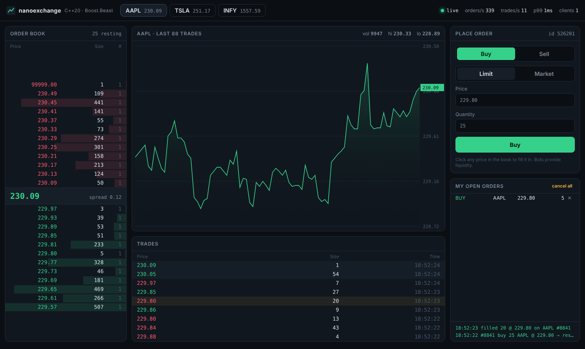
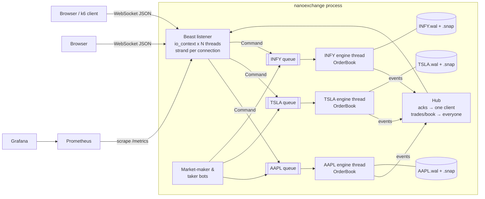

# nanoexchange

A real-time stock exchange simulator: a **C++20 order matching engine** with a **Boost.Beast WebSocket server**, crash recovery through a **write-ahead log**, live market-data streaming to a browser UI, and a full DevOps setup (**Docker, GitHub Actions CI/CD, Prometheus, Grafana, Kubernetes, k6**).



## Highlights

- **Matching engine**: limit and market orders, cancel and cancel-all, strict price-time priority. O(log P) insert, O(1) cancel.
- **One thread per symbol**: each symbol's order book is owned by a single engine thread, so the hot path has no locks and matching is deterministic.
- **Crash recovery**: every command is written to a checksummed write-ahead log *before* it is applied. On restart, snapshot + log replay rebuilds the identical book, even after `kill -9`.
- **WebSockets with Boost.Beast**: async I/O, one strand per connection, private order acks plus broadcast market data. Includes per-client rate limiting, slow-consumer protection and 50 ms market-data batching.
- **Market-maker and taker bots** keep the live demo moving.
- **Observability**: Prometheus `/metrics` (throughput, latency histogram, book size, WAL size, queue depth) and a provisioned Grafana dashboard.
- **CI/CD**: unit tests run normally and under AddressSanitizer and ThreadSanitizer. The Docker image is tested end to end (WebSocket test, kill -9 recovery test, k6 smoke load) and pushed to GHCR.

## Architecture



**Life of an order:** the WebSocket session parses and validates the JSON, then pushes a `Command` into that symbol's bounded queue. The engine thread pops it, assigns an order id, **appends it to the WAL**, matches it against the book, and emits events. The Hub sends the ack privately to the sender, and batches trades and throttled book snapshots to every client.

## Measured performance

Measured on a 2 vCPU cloud VM, Release build. Reproduce with `./build/nx_bench`.

| Scenario | Throughput | Latency |
|---|---|---|
| In-memory matching (1M commands: 55% limit, 25% market, 20% cancel) | **1.58M orders/s** | p50 0.39 µs, p99 1.9 µs |
| Matching + write-ahead log (no fsync) | 527k orders/s | p50 1.3 µs, p99 3.9 µs |
| Matching + WAL + fsync on every write | 5.7k orders/s | p50 155 µs |
| Through queue + engine thread (saturated) | 770k orders/s | |
| End to end over WebSockets, **k6, 50 clients, 1,000 orders/s** + bots | 0 errors | ack round-trip p50 1 ms, p95 14 ms |
| Crash recovery: replay ~1,500 WAL records per symbol | | ~1 ms |

The k6 test ran on the same 2-core machine as the server. k6 itself used ~160% CPU, while the server used ~30%, so the load generator was the limit, not the exchange.

## Two bugs the load test found

1. **Market-data fan-out.** At first, every trade was broadcast as its own message, so 100 clients produced ~25k messages/s and clients fell seconds behind. The fix: the Hub now batches trades per symbol and flushes every 50 ms (conflation), and book snapshots are throttled to 10/s.
2. **Nagle's algorithm.** The p90 ack latency sat at ~45 ms. That's the classic interaction between Nagle's algorithm and delayed ACKs. Setting `TCP_NODELAY` on accepted sockets dropped **p95 from 48 ms to 5 ms**.

## Run it

### Locally

```bash
sudo apt install g++ cmake libboost-dev nlohmann-json3-dev libgtest-dev   # Ubuntu 22.04+
cmake -S . -B build -DCMAKE_BUILD_TYPE=Release
cmake --build build -j
ctest --test-dir build --output-on-failure   # 19 unit tests
./build/nanoexchange                          # open http://localhost:8080
```

### Docker (full stack)

```bash
docker compose up --build
```

| URL | What |
|---|---|
| http://localhost | UI through Nginx (WebSocket proxied) |
| http://localhost:8080 | Exchange directly (`/metrics`, `/health`) |
| http://localhost:9090 | Prometheus |
| http://localhost:3000 | Grafana, with the `nanoexchange` dashboard preloaded |

### Crash-recovery demo

```bash
./build/nanoexchange &            # bots start trading, WAL grows in ./data
kill -9 %1                        # hard crash, no cleanup
./build/nanoexchange              # prints: [recovery] AAPL: ... wal_replayed=1362 ...
```

### Load test

```bash
k6 run -e VUS=50 -e DURATION=60s loadtest/ws_load.js
```

### Kubernetes (minikube)

```bash
minikube start && minikube addons enable ingress
docker build -t nanoexchange:latest . && minikube image load nanoexchange:latest
sed -i 's#ghcr.io/YOUR_GITHUB_USERNAME/nanoexchange:latest#nanoexchange:latest#' deploy/k8s/nanoexchange.yaml
kubectl apply -f deploy/k8s/
kubectl -n nanoexchange port-forward svc/nanoexchange 8080:80
```

### Deploy live (free)

Push to GitHub, then on [Render](https://render.com) choose **New → Blueprint** and select the repo. It reads `render.yaml`, builds the Dockerfile, and gives you a public `https://…onrender.com` URL. WebSockets work there, and the app reads Render's `PORT` variable.

## Configuration

| Variable | Default | Meaning |
|---|---|---|
| `PORT` | 8080 | HTTP + WebSocket port |
| `SYMBOLS` | AAPL,TSLA,INFY | One engine thread per symbol |
| `DATA_DIR` | ./data | WAL + snapshots (`""` = in-memory) |
| `WAL_FSYNC` | 0 | `1` = fdatasync every write (machine-crash safe, slower) |
| `SNAPSHOT_EVERY` | 50000 | Commands between snapshots / WAL compaction |
| `BOTS` | 1 | Run market-maker + taker bots |
| `BOT_TICK_MS` | 250 | Bot loop interval |
| `THREADS` | 2 | Network I/O threads |

## WebSocket protocol

```jsonc
// client -> server
{"op":"new","symbol":"AAPL","side":"buy","type":"limit","price":230.15,"qty":10,"clOrdId":"c1"}
{"op":"new","symbol":"AAPL","side":"sell","type":"market","qty":5}
{"op":"cancel","symbol":"AAPL","id":42}
{"op":"cancel_all","symbol":"AAPL"}

// server -> client
{"type":"ack","symbol":"AAPL","id":42,"clOrdId":"c1","status":"partial","filled":4,"remaining":6, ...}
{"type":"trades","symbol":"AAPL","trades":[{"seq":9,"price":230.15,"qty":4,"side":"buy","buyId":42,"sellId":17,"ts":...}]}
{"type":"book","symbol":"AAPL","bids":[[230.11,120,1], ...],"asks":[...],"last":230.15}
{"type":"stats","ordersPerSec":340,"tradesPerSec":12,"p99us":500,"clients":3}
```

## Project layout

```
src/engine/        order book, WAL + snapshots, engine thread, metrics (no networking)
src/server/        Beast HTTP/WebSocket server, JSON protocol, Hub (fan-out), bots, /metrics
web/               single-page trading UI (vanilla JS + canvas chart)
tests/             GoogleTest unit tests + Python end-to-end WebSocket test
bench/             throughput / latency benchmark
loadtest/          k6 WebSocket load test
deploy/            Nginx, Prometheus, Grafana, Kubernetes manifests
.github/workflows  CI: build, sanitizers, Docker e2e, recovery test, k6, push to GHCR
```

Design decisions and trade-offs are explained in [docs/DESIGN.md](docs/DESIGN.md).
